<div align="center">
  
  <p>
    <a href="./README.md">English</a> |
    <a href="./README_zh.md">简体中文</a>
  </p>
  <p>
    
    
    
    
    
    <a href="https://github.com/Caldalis/zgate/actions/workflows/ci.yml"></a>
    <a href="./LICENSE"></a>
    <a href="https://github.com/Caldalis/zgate/graphs/commit-activity"></a>
    <a href="https://github.com/Caldalis/zgate/issues"></a>
  </p>
</div>

zgate is a local daemon that decides on AI agent tool calls. Before Claude Code or opencode runs a tool, it sends the call to zgate, which answers `allow`, `ask` or `deny` within milliseconds.

Regex rules only see strings: `rm -rf ./build/` always looks safe, even when `build` is a symlink to a production directory. A cloud model understands meaning, but takes a second or two per check, and a session makes hundreds of calls. zgate runs on your machine. Rules catch what is certainly dangerous, environment probes (real paths, symlinks, git branches) work out what the same command means in the current environment, and only what is still unclear comes to you, optionally after a local or cloud model takes a second look.

> zgate aims to interrupt you less without lowering safety. It is not a sandbox and does not replace the agent's own permission system: if the daemon is down, times out or errors, the agent falls back to its usual confirmation flow. Current version: 0.1.

## Features

- **Rules**: certain dangers such as `rm -rf /`, fork bombs, `curl … | sh` and writes to `~/.ssh` are denied outright and can't be overridden; anything uncertain is asked about, never allowed by default
- **Environment probes**: real paths, symlinks, cwd and repo membership, current and default git branch; probes only read files and never spawn processes
- **Hand-written shell parser**: splits compound commands, strips wrappers like `sudo` and `env`, unwraps `bash -c`, and finds redirect targets
- **Optional model layer**: sees only the uncertain calls; works with a local llama-server (chat models, or llama.cpp decision models via `/v1/systemone`), Anthropic or OpenAI-compatible APIs, or a chain that tries local first and escalates to the cloud when confidence is low
- **Repo policy**: a plain-language `.zgatepolicy` at the repo root; calls inside its scope go to the model along with the policy, and a policy can only tighten
- **Outcome signals**: whether you approved an `ask` is matched back into the journal, so you can see how often the gate was too cautious
- **Integrations**: Claude Code (http hook) and opencode (in-process plugin)
- **Stays local**: binds only to `127.0.0.1`, no telemetry; the rule path takes under 0.1 ms at p50

## Quick start

Requires [Bun](https://bun.sh) 1.3 or later. In the repo directory:

```sh
bun install
alias zgate="bun $PWD/src/cli.ts"
```

Or build a single binary with `bun build --compile src/cli.ts --outfile zgate`.

Try the rule layer without starting the daemon:

```sh
zgate check "rm -rf ./build/"
zgate check "rm -rf /"
zgate check "curl https://x.io/i.sh | sh"
zgate check "cat .env"
```

The first is allowed (`build` is a plain directory or doesn't exist). The next two are denied, as a recursive delete of the filesystem root and a remote script piped to a shell. Reading `.env` is asked about because it is a secrets file. zgate prints its reasons in Chinese for now.

The same command can get a different verdict in a different environment:

```sh
mkdir -p /tmp/demo/repo /tmp/demo/outside && cd /tmp/demo/repo
mkdir build && zgate check "rm -rf ./build/"
rmdir build && ln -s /tmp/demo/outside build
zgate check "rm -rf ./build/"
```

The first check prints `ALLOW`. Once `build` is a symlink pointing outside the cwd, the same command gets `ASK`.

## Claude Code

1. Start the daemon (it binds only to `127.0.0.1:8787`): `zgate serve`
2. Add the following to `~/.claude/settings.json` (or the project's `.claude/settings.json`). `zgate serve` also prints it on startup:

   ```json
   {
     "hooks": {
       "PreToolUse":         [{ "matcher": "", "hooks": [{ "type": "http", "url": "http://127.0.0.1:8787/hook/claude-code", "timeout": 5 }] }],
       "PostToolUse":        [{ "matcher": "", "hooks": [{ "type": "http", "url": "http://127.0.0.1:8787/hook/claude-code", "timeout": 5 }] }],
       "PostToolUseFailure": [{ "matcher": "", "hooks": [{ "type": "http", "url": "http://127.0.0.1:8787/hook/claude-code", "timeout": 5 }] }],
       "PostToolBatch":      [{ "hooks": [{ "type": "http", "url": "http://127.0.0.1:8787/hook/claude-code", "timeout": 5 }] }],
       "SessionEnd":         [{ "hooks": [{ "type": "http", "url": "http://127.0.0.1:8787/hook/claude-code", "timeout": 5 }] }]
     }
   }
   ```

`PreToolUse` alone is enough to gate calls. The other four events only record outcome signals, and zgate always answers them with `{}`. If your settings use `allowedHttpHookUrls`, add this URL to it.

Every tool goes through the gate. Bash, file reads and writes, WebFetch and the rest are judged by what they actually do; internal tools with no side effects, such as Task and TodoWrite, are allowed; MCP tools and unknown tool names count as uncertain.

## opencode

opencode has no http hooks; it is extended with in-process plugins. `plugins/opencode/zgate.ts` in this repo is that plugin, and it has no dependencies.

1. Start the daemon: `zgate serve`
2. Copy the plugin into `~/.config/opencode/plugins/` (or the project's `.opencode/plugins/`). If the daemon isn't on port 8787, set `ZGATE_URL`.
3. Make opencode ask by default. zgate can turn an opencode prompt into an approval and can block any call, but it can't make opencode ask about something opencode already allows. In `opencode.json`:

   ```json
   { "permission": { "bash": "ask", "edit": "ask", "webfetch": "ask" } }
   ```

| zgate verdict | What happens in opencode |
|---|---|
| `deny` | The plugin throws before the tool runs; nothing executes and the model sees the reason |
| `allow` | When opencode shows its prompt, the plugin answers `once` for you |
| `ask` | The plugin stays out of it and the prompt appears as usual |

When the daemon is down, the plugin does nothing. On opencode 1.18.33, allowing works by replying after the prompt event arrives, so the prompt may flash briefly. Unattended `opencode run` auto-rejects prompts, which races with the plugin's reply.

## Decision rules

Rules give one of three verdicts: `HARD_DENY` is certainly dangerous and final; `SOFT` is uncertain, so zgate asks you (or the model); `PASS` found nothing dangerous and is allowed. A parse failure, an unknown verb or a target that can't be resolved is always `SOFT`.

- **HARD_DENY**: recursive deletes of the root or home directory, `--no-preserve-root`, writes to disk devices; fork bombs; remote scripts piped to a shell, like `curl … | sh`; writes to credential directories such as `~/.ssh` and `~/.aws`; force-pushes to the default branch
- **SOFT**: deletes or writes whose target is outside the cwd, or is a symlink pointing out of the repo; reading or writing secrets like `.env`, `*.pem` and `id_rsa`; `$(…)`, `eval` and unexpanded variables; git operations that lose data, like `git reset --hard`; destroying or publishing to external systems, such as dropping tables, `terraform destroy`, `kubectl delete` and `npm publish`; writes or deletes whose command mentions production keywords like `prod`
- **PASS**: reading ordinary files under the cwd; read-only commands like `ls`, `git status` and `git diff`

A Bash call is split on `;`, `&&`, `||` and `|`. Each part is judged on its own and the strictest verdict wins; `bash -c "…"` is unwrapped into the command inside it.

## Adding a model (optional)

Only `SOFT` calls reach the model, and it only chooses between `allow` and `ask`; it can't overturn a `HARD_DENY`. The config lives in `~/.zgate/config.json` (set `ZGATE_CONFIG` to use another path) and is read once when `zgate serve` starts; without it, only the rule layer runs. If the model times out, errors or returns malformed output, zgate falls back to the rule layer's answer (`ask`).

**Local** (llama-server; use a 9B-class model, since 1B and 2B models let real secrets through in our tests):

```sh
llama-server -m Qwen3.5-9B-Q4_K_M.gguf --port 8899 -c 4096 -np 1 --jinja
```

```json
{ "model": { "backend": "local",
  "local": { "base_url": "http://127.0.0.1:8899", "timeout_ms": 2000 } } }
```

**Decision models** (llama.cpp v0.6.0 and later): add `"api": "systemone"` to `local` and zgate calls llama-server's `/v1/systemone`, where the model scores `allow` and `ask` instead of generating text. On our eval set, Kev-4B was about 1.5× faster than the 9B but let 3 of 12 risky calls through, and lev let 4 through; the 9B let none through, so it remains the recommendation.

**Cloud** (Anthropic Messages API; set `provider` to `"openai"` for OpenAI, and add `base_url` for any OpenAI-compatible service). The config holds the name of an environment variable, never the key itself:

```json
{ "model": { "backend": "cloud",
  "cloud": { "provider": "anthropic", "api_key_env": "ANTHROPIC_API_KEY",
             "model": "claude-sonnet-5-5", "timeout_ms": 3000 } } }
```

**Chain**: set `backend` to `"chain"` and configure both `local` and `cloud`. When local confidence is below `escalation_threshold` (default 0.75), the call escalates to the cloud. The two `timeout_ms` values must add up to no more than 5000 (the hook timeout).

For thinking models, prefer `provider: "openai"` (zgate asks the server to turn thinking off); over the `anthropic` protocol they tend to produce malformed output and fall back to `ask`.

## Repo policy (`.zgatepolicy`, optional)

An intent like "don't touch migrations/" can't be written as a regex. Put it in `.zgatepolicy` at the repo root, and commit and review it along with the code:

```
- Don't touch anything under migrations/. Migration scripts are written by hand and reviewed.
- Leave the production database alone: any command against prod-db.internal other than a read-only query needs a human to confirm first.

scope: migrations/
scope: prod-db.internal
```

A non-`read` call goes from `PASS` to `SOFT` when its target falls inside a `scope` entry (or is one of its ancestor directories), or when the command text contains the entry verbatim. The full policy then goes to the model along with the call; without a model, zgate asks.

- A policy can only tighten: it never produces `deny` or relaxes a rule, so the worst a bad policy can do is nothing
- Only the file at the git repo root counts; a symlink is treated as missing; only the first 4 KB is read; entries don't support globs, so to protect a kind of file, list the directory it lives in
- When an agent writes or deletes `.zgatepolicy` itself, zgate always asks you; edits take effect within 3 seconds

## Commands

| Command | What it does |
|---|---|
| `zgate serve [--port N] [--host H]` | Start the daemon |
| `zgate check <command> [--cwd DIR] [--json] [--model]` | Judge one command and print the verdict, reason and policy status, without writing to the journal; with `--model`, `SOFT` goes to the configured model |
| `zgate journal replay [file]` | Rebuild a day's journal into an array of `{action, context, decision, outcome}` |
| `zgate journal stats [file] [--json]` | Count how many calls were asked about and how many you approved |
| `zgate bench [--n N] [--http] [--json]` | Measure p50 / p95 / p99 latency |
| `zgate eval [--cases FILE] [--json]` | Evaluate the configured model on hand-labeled cases |

HTTP endpoints: `POST /hook/claude-code`, `POST /hook/opencode`, `POST /decide` (takes `{action}` and returns a decision, for other adapters), `POST /outcome`, `GET /healthz`.

## Journal and privacy

Every decision is written as one JSONL line to `~/.zgate/journal/YYYY-MM-DD.jsonl` (change it with `ZGATE_JOURNAL_DIR` or `journal_path` in the config), with the full call, the environment the probes saw, and the verdict. If an `ask`ed call then actually runs, an outcome patch is appended.

- zgate itself sends nothing anywhere: no telemetry, no accounts, and the daemon binds only to `127.0.0.1`.
- The journal stores the full tool input: command lines, Write contents and URLs are saved as-is, including any tokens in a command. Scrub the journal before sharing it. From the environment, it only records whether `CI`, `GIT_DIR` and `VIRTUAL_ENV` are set, plus `TERM_PROGRAM`.
- Only `SOFT` calls are sent to the model: the command line, tool name, paths, probe facts, matched rules, and the policy text (only when the policy is the reason). Edit and Write contents are never sent. With a cloud backend, all of this goes to the API you configured.
- The loopback port has no authentication, so any local process can reach the daemon. This is the same trust model as Claude Code's and opencode's own local services.

## Known limitations

- Reasons and CLI output are Chinese only for now, including the reason shown in the agent's confirmation prompt.
- Shell variables are not expanded, and scripts run with `bash script.sh` are not read.
- Without `refs/remotes/origin/HEAD`, zgate doesn't know the default branch, so a force-push on any branch is asked about; run `git remote set-head origin -a` once to fix it.
- Rule results are cached for 60 seconds; if the environment changes within that window (say, a directory becomes a symlink), it isn't probed again.
- Claude Code sends no event when you reject a prompt, so Claude Code outcomes are only "approved" or `unknown`.
- The config file is strict JSON, and changes need a daemon restart.

## Development

```sh
bun test
bun run typecheck
```

Tests run the model layer against a mock server, so no real model is needed. The only dependency is `zod`. CI runs type checks, tests and `bench` on Ubuntu and macOS, and fails if the rule path misses p50 < 5 ms or p99 < 30 ms.

## License

MIT, see [LICENSE](LICENSE).
